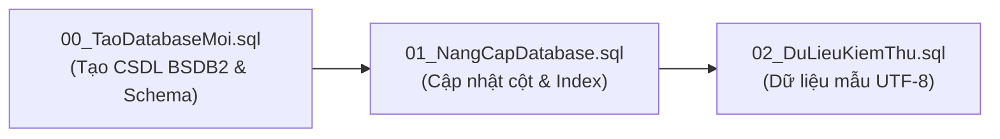

# Hướng dẫn Khởi tạo & Chạy Dự án trên Microsoft Visual Studio (MVS)

> Hướng dẫn toàn diện dành cho lập trình viên phát triển hệ thống **WebBanSach** trên môi trường Windows bằng **Microsoft Visual Studio 2019/2022**, **SQL Server Management Studio (SSMS)** và **IIS Express**.

---

## 1. Yêu cầu Hệ thống & Chuẩn bị Môi trường

Để phát triển và chạy dự án trơn tru trên Windows, máy tính cần cài đặt các phần mềm sau:

| Phần mềm | Phiên bản khuyến nghị | Ghi chú cấu hình |
|---|---|---|
| **Hệ điều hành** | Windows 10 / 11 (64-bit) | Hỗ trợ tối ưu cho .NET Framework & IIS Express |
| **Microsoft Visual Studio (MVS)** | Visual Studio 2019 hoặc 2022 (Bản Community miễn phí) | Cần chọn Workload: **`ASP.NET and web development`** |
| **Targeting Pack** | **`.NET Framework 4.8 Targeting Pack`** | Cài đặt thông qua *Visual Studio Installer* $\rightarrow$ *Individual components* |
| **Cơ sở dữ liệu** | **Microsoft SQL Server** (2019 / 2022 / Express) | Bản phổ biến nhất là SQL Server Express: instance mặc định là `.\SQLEXPRESS` |
| **Công cụ quản trị CSDL** | **SQL Server Management Studio (SSMS)** | Dùng để mở và thực thi các script SQL |

> [!TIP]
> Nếu bạn mới cài Visual Studio, hãy mở **Visual Studio Installer** $\rightarrow$ chọn **Modify** tại phiên bản VS của bạn $\rightarrow$ tích chọn workload **ASP.NET and web development**, chuyển sang tab **Individual components**, tìm kiếm và tích chọn **.NET Framework 4.8 Targeting Pack** rồi bấm **Install**.

---

## 2. Khởi tạo Cơ sở Dữ liệu & Chạy các Script SQL (Run Init Scripts)

Dự án có 3 script chính được quản lý tập trung. Với máy tính mới hoặc cơ sở dữ liệu mới, chạy theo thứ tự sau:



### Bước 2.1: Mở SQL Server Management Studio (SSMS)
- Khởi động SSMS.
- Chọn Server type: `Database Engine`.
- Server name: `.\SQLEXPRESS` (hoặc tên máy chủ SQL cục bộ của bạn, ví dụ: `localhost`).
- Authentication: `Windows Authentication`.
- Bấm **Connect**.

### Bước 2.2: Thực thi lần lượt các Script SQL
1. **Chạy `00_TaoDatabaseMoi.sql`:**
   - Trong SSMS: Chọn **File** $\rightarrow$ **Open** $\rightarrow$ **File...** $\rightarrow$ chọn file `00_TaoDatabaseMoi.sql`.
   - Nhấn **F5** (Execute) để tạo database `BSDB2` và toàn bộ các bảng cơ sở.
2. **Chạy `01_NangCapDatabase.sql`:**
   - Mở file `01_NangCapDatabase.sql` trong SSMS.
   - Nhấn **F5** (Execute) để cập nhật các cột nâng cấp (`EmailVerified`, `Tracking`, `GhiChu`, kiểu dữ liệu `BigInt`). Script này an toàn để chạy nhiều lần (Idempotent).
3. **Chạy `02_DuLieuKiemThu.sql`:**
   - Mở file `02_DuLieuKiemThu.sql` trong SSMS.
   - Nhấn **F5** (Execute) để nạp các tài khoản mẫu (`testuser`, `admin`), danh mục sách chuẩn, đơn hàng và các bài đánh giá có dấu tiếng Việt.

> [!IMPORTANT]
> Nếu chạy `02_DuLieuKiemThu.sql` bằng công cụ dòng lệnh `sqlcmd`, luôn luôn sử dụng tham số `-f 65001` để bảo tồn bảng mã ký tự tiếng Việt UTF-8:
> ```powershell
> sqlcmd -S .\SQLEXPRESS -E -d BSDB2 -f 65001 -i 02_DuLieuKiemThu.sql
> ```

---

## 3. Cấu hình Chuỗi Kết nối trong Visual Studio

1. Mở file giải pháp `WebBanSach.sln` trong Visual Studio.
2. Mở file `backend/Web.config`.
3. Kiểm tra thẻ `<connectionStrings>`:
   ```xml
   <connectionStrings>
       <add name="BSDBContext" 
            connectionString="metadata=res://*/Models.Data.BSDBContext.csdl|res://*/Models.Data.BSDBContext.ssdl|res://*/Models.Data.BSDBContext.msl;provider=System.Data.SqlClient;provider connection string=&quot;data source=.\SQLEXPRESS;initial catalog=BSDB2;integrated security=True;multipleactiveresultsets=True;App=EntityFramework&quot;" 
            providerName="System.Data.EntityClient" />
   </connectionStrings>
   ```
   *Nếu SQL Server của bạn có tên instance khác (ví dụ `localhost` hoặc tên máy tính), hãy thay `data source=.\SQLEXPRESS` bằng tên tương ứng.*

---

## 4. Khởi chạy Ứng dụng với IIS Express

1. Trong cửa sổ **Solution Explorer**, click chuột phải vào project `backend` $\rightarrow$ chọn **Set as Startup Project**.
2. Click chuột phải vào `backend` $\rightarrow$ chọn **Restore NuGet Packages** để tự động tải các thư viện Entity Framework, MVC, Newtonsoft.Json...
3. Nhấn tổ hợp phím **Ctrl + Shift + B** để biên dịch toàn bộ Solution (Build Solution). Xác nhận kết quả hiển thị `Build: 1 succeeded, 0 failed`.
4. Nhấn **Ctrl + F5** (Start Without Debugging) hoặc **F5** (Start Debugging) để mở ứng dụng với máy chủ IIS Express.
5. Trình duyệt mặc định sẽ tự động mở trang web:
   - **Trang chủ Khách hàng:** `http://localhost:[Port]/index.html`
   - **Trang Quản trị:** `http://localhost:[Port]/admin.html`

---

## 5. Khắc phục Sự cố Thường gặp (Troubleshooting)

### 5.1. Lỗi hiển thị tiếng Việt có dấu dạng ký tự lạ (Mojibake)
- **Nguyên nhân:** Dữ liệu SQL được nạp không thông qua Code Page 65001 (UTF-8).
- **Khắc phục:** Mở file `02_DuLieuKiemThu.sql` trực tiếp bằng SSMS và bấm Execute (F5), hoặc chạy lại lệnh `sqlcmd` với cờ `-f 65001`.

### 5.2. Lỗi "Cannot open database 'BSDB2' requested by the login"
- **Nguyên nhân:** Chưa thực thi script tạo CSDL `00_TaoDatabaseMoi.sql`.
- **Khắc phục:** Thực thi `00_TaoDatabaseMoi.sql` trên SSMS để tạo mới cơ sở dữ liệu `BSDB2`.

### 5.3. Thư mục mã OTP không thể ghi file
- **Nguyên nhân:** Tài khoản IIS Express chưa có quyền ghi vào thư mục `App_Data/OtpEmails`.
- **Khắc phục:** Tạo thư mục `backend/App_Data/OtpEmails` (nếu chưa có) và cấp quyền Write cho người dùng máy tính của bạn.
