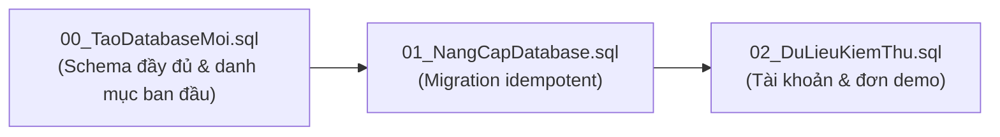

# HƯỚNG DẪN KHỞI TẠO & CHẠY DỰ ÁN TRÊN MICROSOFT VISUAL STUDIO (MVS)

> Hướng dẫn khởi tạo SQL Server và chạy WebBanSach bằng Visual Studio/IIS Express, cùng thứ tự áp dụng schema và dữ liệu demo.

---

## 1. Yêu cầu Hệ thống & Chuẩn bị Môi trường

Để chạy dự án mượt mà trên Windows bằng Visual Studio, máy tính của bạn cần được cài đặt các phần mềm sau:

| Phần mềm | Phiên bản khuyến nghị | Ghi chú cấu hình |
|---|---|---|
| **Hệ điều hành** | Windows 10 / 11 (64-bit) | Hỗ trợ tốt nhất cho .NET Framework & IIS Express |
| **Microsoft Visual Studio (MVS)** | Visual Studio 2019 hoặc 2022 (Bản Community miễn phí) | Cần chọn Workload: **`ASP.NET and web development`** |
| **Targeting Pack** | **`.NET Framework 4.8 Targeting Pack`** | Cài đặt thông qua *Visual Studio Installer* -> *Individual components* |
| **Cơ sở dữ liệu** | **Microsoft SQL Server** (2019 / 2022 / Express) | Bản phổ biến nhất là SQL Server Express: tên instance mặc định là `.\SQLEXPRESS` |
| **Công cụ quản trị CSDL** | **SQL Server Management Studio (SSMS)** | Dùng để mở và thực thi các script SQL |

> [!TIP]
> Nếu bạn mới cài Visual Studio, hãy mở **Visual Studio Installer** -> chọn **Modify** tại phiên bản VS của bạn -> tích chọn workload **ASP.NET and web development**, chuyển sang tab **Individual components**, tìm kiếm và tích chọn **.NET Framework 4.8 Targeting Pack** rồi bấm **Install**.

---

## 2. Khởi tạo Cơ sở Dữ liệu & Chạy các Script SQL (Run Init Scripts)

Dự án có ba script chính. Với database mới, chạy theo thứ tự sau:



### Bước 2.1: Mở SQL Server Management Studio (SSMS)
1. Mở ứng dụng **SQL Server Management Studio (SSMS)** trên máy tính.
2. Tại cửa sổ **Connect to Server**:
   - **Server type**: `Database Engine`
   - **Server name**: Điền tên instance SQL của bạn (Ví dụ: `.\SQLEXPRESS`, `localhost`, hoặc `.` nếu là bản mặc định).
   - **Authentication**: `Windows Authentication` (hoặc `SQL Server Authentication` nếu dùng tài khoản `sa`).
   - Bấm **Connect**.

---

### Bước 2.2: Chạy Script 1 — `00_TaoDatabaseMoi.sql` (Khởi tạo CSDL & Bảng cơ sở)
- **Mục đích**: Tạo `BSDB2`, các bảng cốt lõi, dữ liệu sách ban đầu, các thể loại/NXB phổ biến, admin demo, giảm giá mặc định 0%, và bảng đánh giá `DanhGiaSach`.
- **Cách chạy trên SSMS**:
  1. Trong SSMS, bấm menu **File** -> **Open** -> **File...** (hoặc nhấn `Ctrl + O`).
  2. Trỏ đến thư mục dự án và chọn file `00_TaoDatabaseMoi.sql`.
  3. Bấm nút **Execute** (hoặc nhấn phím **`F5`**).
  4. Kiểm tra cửa sổ *Messages* phía dưới hiển thị: `Commands completed successfully.`

---

### Bước 2.3: Chạy Script 2 — `01_NangCapDatabase.sql` (Nâng cấp Schema & An toàn dữ liệu)
- **Mục đích**: Bổ sung các trường và tính năng hiện đại cho hệ thống:
  - Thêm cột `EmailVerified` (xác thực email khách hàng).
  - Nâng cấp độ dài `MatKhau` lên 256 ký tự (chuẩn hóa băm mật khẩu PBKDF2-SHA256).
  - Thêm cột `ThanhToan` (0: COD, 1: Thẻ tín dụng đã thanh toán).
  - Thêm cột `Tracking` (tiến trình giao hàng: 0-Chờ xử lý, 1-Đã đóng gói, 2-Đang giao, 3-Đã giao, 4-Đã hủy).
  - Thêm cột `GhiChu` (lưu trữ ghi chú đặt hàng từ khách hàng).
  - Thêm `GiamGia` mặc định 0 và bảng `DanhGiaSach` (1–5 sao, mỗi khách/sách một đánh giá).
  - Chuyển `Sach.SoLuongTon` và `ChiTietDDH.SoLuong` sang BIGINT.
  - Tạo chỉ mục ràng buộc duy nhất `UX_KhachHang_TaiKhoan`.
- **Cách chạy trên SSMS**:
  1. Bấm `Ctrl + O`, mở file `01_NangCapDatabase.sql`.
  2. Nhấn phím **`F5`** (Execute).
  3. Đảm bảo hiển thị thông báo thành công.

---

### Bước 2.4: Chạy Script 3 — `02_DuLieuKiemThu.sql` (Nạp dữ liệu kiểm thử hoàn chỉnh)
- **Mục đích**: Thiết lập sẵn môi trường kiểm thử hoàn chỉnh mà không cần nhập liệu thủ công:
  - Nạp lại tồn kho 100 cuốn cho tất cả các đầu sách (không lo hết hàng).
  - Tạo sẵn tài khoản khách hàng chuẩn: `testuser` (đã xác minh), `testotp` (chưa xác minh), `customer_vip`, `customer_locked`.
  - Tạo tài khoản quản trị: `admin` (`123456`), `manager` (`123456`).
  - Nạp sẵn 5 đơn hàng mẫu bao quát đầy đủ trạng thái kèm ghi chú đơn hàng mẫu.
  - Đảm bảo có thêm thể loại Manga/Kinh dị/Trinh thám/Khoa học viễn tưởng và các NXB phổ biến.
- **Cách chạy trên SSMS**:
  1. Bấm `Ctrl + O`, mở file `02_DuLieuKiemThu.sql`.
  2. Nhấn phím **`F5`** (Execute).
  3. Cửa sổ *Messages* sẽ hiển thị: `=== KHỞI TẠO DỮ LIỆU KIỂM THỬ THÀNH CÔNG ===`.

---

### Bước 2.5: Kiểm tra nhanh Cơ sở Dữ liệu đã sẵn sàng
Mở một cửa sổ New Query trong SSMS và chạy câu lệnh sau để kiểm tra:
```sql
USE BSDB2;
GO
SELECT 'TongSoSach' AS Loai, COUNT(*) AS SoLuong FROM Sach
UNION ALL
SELECT 'TongKhachHang', COUNT(*) FROM KhachHang
UNION ALL
SELECT 'TongDonHang', COUNT(*) FROM DonDatHang;
```
> Nếu kết quả trả về đầy đủ số lượng sách (~17 đầu sách), khách hàng và đơn hàng thì CSDL đã sẵn sàng 100%!

> `01_NangCapDatabase.sql` đã bao gồm việc khôi phục `GhiChu` và nâng BIGINT. Hai script `03_KhoiPhucGhiChuDonHang.sql` và `04_SoLuongBigInt.sql` chỉ là bản sửa riêng cho môi trường thiếu đúng thay đổi đó; không cần chạy sau `01` thành công.

---

## 3. Mở Dự án & Cấu hình Kết nối CSDL trong Visual Studio

### Bước 3.1: Mở Solution
1. Điều hướng đến thư mục dự án `c:\Project\WebBanSach_Final`.
2. Nhấp đúp vào file **`WebBanSach.sln`** để mở bằng Visual Studio.
3. Trong cửa sổ **Solution Explorer**, bạn sẽ thấy project `WebBanSach` (nằm trong thư mục `backend/`).

---

### Bước 3.2: Cấu hình Chuỗi Kết nối CSDL (`Web.config`)
Mở file **`Web.config`** trong thư mục `backend/` (hoặc mở trực tiếp từ Solution Explorer). Tìm đến thẻ `<connectionStrings>` (khoảng dòng 85):

```xml
<connectionStrings>
  <add name="BSDBContext" 
       connectionString="Data Source=.\SQLEXPRESS;Initial Catalog=BSDB2;Integrated Security=True;MultipleActiveResultSets=True;" 
       providerName="System.Data.SqlClient" />
</connectionStrings>
```

Tùy vào phiên bản SQL Server cài trên máy của bạn, hãy điều chỉnh giá trị `Data Source`:

| Môi trường SQL Server trên máy bạn | Cấu hình `Data Source` tương ứng |
|---|---|
| **SQL Server Express (Phổ biến nhất)** | `Data Source=.\SQLEXPRESS;Initial Catalog=BSDB2;Integrated Security=True;` |
| **SQL Server LocalDB (Đi kèm Visual Studio)** | `Data Source=(localdb)\MSSQLLocalDB;Initial Catalog=BSDB2;Integrated Security=True;` |
| **SQL Server Bản mặc định (Default Instance)** | `Data Source=.;Initial Catalog=BSDB2;Integrated Security=True;` hoặc `Data Source=localhost;...` |
| **Dùng tài khoản `sa` có mật khẩu** | `Data Source=localhost;Initial Catalog=BSDB2;User Id=sa;Password=MatKhauCuaBan;` |

---

### Bước 3.3: Cấu hình Chế độ Gửi Mã OTP Email (`appSettings`)
Trong cùng file `Web.config`, xem phần `<appSettings>`:

```xml
<appSettings>
  <!-- Chế độ OTP Email: "LocalPickup" (Lưu file để test) hoặc "Smtp" (Gửi email thật) -->
  <add key="EmailOtpMode" value="LocalPickup" />
  <add key="GmailSenderEmail" value="email_cua_ban@gmail.com" />
  <add key="GmailAppPassword" value="mat_khau_ung_dung" />
  ...
</appSettings>
```

- **Khi chạy kiểm thử trên máy cá nhân (Khuyên dùng `LocalPickup`)**:
  - Đặt `EmailOtpMode` thành `LocalPickup`.
  - Khi gửi mã trên localhost, thư test được ghi trong `backend/App_Data/OtpEmails/`; trang xác minh có thể nhận và tự điền mã test. Không dùng chế độ này trên máy chủ công khai.
- **Khi muốn gửi email thật đến hộp thư của người dùng**:
  - Đặt `EmailOtpMode` thành `Smtp`.
  - Điền tài khoản Gmail và Mật khẩu ứng dụng (App Password) vào 2 khóa `GmailSenderEmail` và `GmailAppPassword`.

---

## 4. Build & Khởi động Dự án trên Visual Studio (IIS Express)

### Bước 4.1: Khôi phục Thư viện (Restore NuGet Packages)
1. Trong cửa sổ **Solution Explorer**, nhấp chuột phải vào dòng đầu tiên: **Solution 'WebBanSach'**.
2. Chọn **Restore NuGet Packages**.
3. Visual Studio sẽ tự động tải các gói phụ thuộc (EntityFramework, Microsoft.AspNet.Mvc, Newtonsoft.Json...) vào thư mục `packages/`.

---

### Bước 4.2: Thiết lập Project Khởi động & Cấu hình Trang Mặc định
1. Nhấp chuột phải vào project **`WebBanSach`** trong Solution Explorer -> Chọn **Set as Startup Project**.
2. Nhấp chuột phải vào project **`WebBanSach`** -> Chọn **Properties** (hoặc nhấn tổ hợp phím `Alt + Enter`).
3. Chọn tab **Web** ở menu bên trái:
   - Tại mục **Start Action**: Chọn **Specific Page**, điền vào ô là: `index.html`.
   - Tại mục **Servers**:
     - Chọn **IIS Express**.
     - Mục **Project Url**: Bạn có thể giữ nguyên cổng mặc định do Visual Studio tạo (ví dụ: `http://localhost:54921/` hoặc đổi sang `http://localhost:8084/`).
     - Bấm **Create Virtual Directory** nếu có nút này.
4. Bấm `Ctrl + S` để lưu cấu hình Properties.

---

### Bước 4.3: Biên dịch Dự án (Rebuild Solution)
1. Trên thanh menu, chọn **Build** -> **Rebuild Solution** (hoặc phím tắt: **`Ctrl + Shift + B`**).
2. Theo dõi cửa sổ **Output** ở phía dưới màn hình:
   ```text
   ========== Rebuild All: 1 succeeded, 0 failed, 0 skipped ==========
   ```
   > Đảm bảo kết quả là **1 succeeded, 0 failed**!

---

### Bước 4.4: Khởi chạy Ứng dụng
- Để chạy bình thường: Nhấn tổ hợp phím **`Ctrl + F5`** (Start Without Debugging - Chạy nhanh nhất, không bị gián đoạn).
- Để chạy chế độ Debug (có thể đặt Breakpoint): Nhấn phím **`F5`** (Start Debugging).

Trình duyệt mặc định của bạn sẽ tự động mở trang chủ:  
👉 **`http://localhost:<PORT>/index.html`**

---

## 5. Danh sách Đường dẫn & Tài khoản Kiểm thử Nhanh

Khi chạy trên IIS Express, toàn bộ các chức năng đã sẵn sàng để bạn trải nghiệm:

### 5.1. Các đường dẫn chính của Website

| Tính năng | Đường dẫn (URL) | Mô tả |
|---|---|---|
| **Trang chủ (Cửa hàng)** | `http://localhost:<PORT>/index.html` | Xem danh sách sách, tìm kiếm, lọc theo thể loại, banner nổi bật |
| **Chi tiết Sách** | `http://localhost:<PORT>/book-details.html?id=33` | Xem thông tin chi tiết, tác giả, mô tả và nút Thêm vào giỏ hàng |
| **Giỏ hàng** | `http://localhost:<PORT>/cart.html` | Tính toán tiền tức thì khi tăng/giảm số lượng mà không cần tải lại trang |
| **Thanh toán** | `http://localhost:<PORT>/checkout.html` | Hỗ trợ 2 hình thức: **COD** hoặc **Thẻ tín dụng** (kèm xem trước thẻ trực quan và ô Ghi chú đơn hàng) |
| **Theo dõi đơn hàng** | `http://localhost:<PORT>/tracking.html` | Lịch sử mua hàng, trạng thái vận chuyển, địa chỉ nhận và ghi chú đơn |
| **Đăng nhập** | `http://localhost:<PORT>/login.html` | Đăng nhập tài khoản khách hàng |
| **Đăng ký** | `http://localhost:<PORT>/register.html` | Đăng ký thành viên mới |
| **Xác minh Email (OTP)** | `http://localhost:<PORT>/verify-email.html` | Nhập mã OTP 6 số để kích hoạt tài khoản |
| **Trang Quản trị (Admin)** | `http://localhost:<PORT>/admin.html` | CRUD sách, tìm catalog, xem chi tiết đơn, cập nhật trạng thái và kiểm duyệt đánh giá |

---

### 5.2. Danh sách Tài khoản Kiểm thử có sẵn (trong `02_DuLieuKiemThu.sql`)

#### Tài khoản Khách hàng (Customer):
- **Tài khoản chuẩn**: `testuser` / Mật khẩu: `12345678` (Đã xác minh email, có sẵn 5 đơn hàng mẫu để kiểm thử theo dõi và hủy đơn).
- **Tài khoản test OTP**: `testotp` / Mật khẩu: `12345678` (Chưa xác minh email, tự động chuyển vào luồng nhập OTP khi đăng nhập).
- **Tài khoản VIP**: `customer_vip` / Mật khẩu: `12345678`.

#### Tài khoản Quản trị viên (Admin):
- Truy cập tại: `http://localhost:<PORT>/admin.html`
- **Tài khoản Admin chính**: `admin` / Mật khẩu: `123456`
- **Tài khoản Quản lý đơn**: `manager` / Mật khẩu: `123456`

#### Thẻ Tín dụng Kiểm thử Mẫu (Dùng tại trang Checkout):
- **Số thẻ**: `4532 8888 8888 8888` (Visa)
- **Tên chủ thẻ**: `NGUYEN VAN TEST`
- **Ngày hết hạn**: `12/28` (hoặc bất kỳ tháng nào trong tương lai)
- **Mã CVV**: `888`
*(Hoặc chỉ cần bấm nút **"Thử thẻ mẫu"** trên giao diện checkout để tự động điền)*

---

## 6. Xử lý Sự cố Thường gặp (Troubleshooting & FAQs)

### ❓ Sự cố 1: Lỗi kết nối CSDL `Cannot open database "BSDB2" requested by the login`
- **Nguyên nhân**: Bạn chưa chạy script `00_TaoDatabaseMoi.sql` để tạo database `BSDB2`, hoặc tên CSDL trong `Web.config` bị gõ sai.
- **Khắc phục**: Mở SSMS, mở file `00_TaoDatabaseMoi.sql` và bấm **Execute (F5)** để tạo CSDL.

### ❓ Sự cố 2: Lỗi thiếu cột `Invalid column name 'GhiChu'` hoặc `'EmailVerified'` hoặc `'Tracking'`
- **Nguyên nhân**: Cơ sở dữ liệu cũ chưa được cập nhật các trường mới của hệ thống.
- **Khắc phục**: Mở SSMS, chạy file `01_NangCapDatabase.sql` để hệ thống tự động bổ sung các cột còn thiếu.

### ❓ Sự cố 3: Lỗi biên dịch `Could not load type 'WebBanSach.MvcApplication'`
- **Nguyên nhân**: File DLL `Project8.dll` trong thư mục `bin/` chưa được biên dịch hoặc bị khóa bởi tiến trình cũ.
- **Khắc phục**: 
  1. Tắt IIS Express ở thanh Taskbar góc dưới bên phải màn hình.
  2. Trong Visual Studio, chọn **Build** -> **Clean Solution**.
  3. Chọn **Build** -> **Rebuild Solution** (`Ctrl + Shift + B`).

### ❓ Sự cố 4: Lỗi `A network-related or instance-specific error occurred while establishing a connection to SQL Server`
- **Nguyên nhân**: Dịch vụ SQL Server chưa được bật hoặc sai tên `Data Source`.
- **Khắc phục**:
  1. Nhấn tổ hợp phím `Windows + R`, gõ `services.msc` và nhấn Enter.
  2. Tìm dịch vụ có tên **SQL Server (SQLEXPRESS)** hoặc **SQL Server (MSSQLSERVER)** -> Chuột phải chọn **Start** nếu đang bị dừng.
  3. Mở `backend/Web.config`, đảm bảo tên server trong `Data Source` trùng khớp hoàn toàn với tên server bạn đăng nhập trong SSMS.

---

